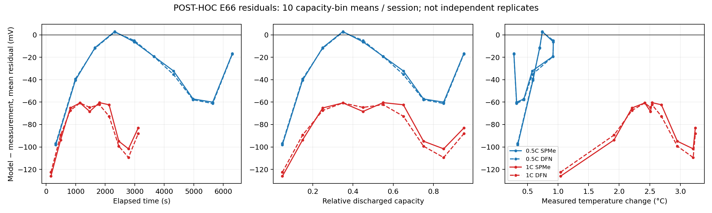

# Auditoria adversarial E66 1C — 25/10/2026

**Veredito: a falha original em 1C permanece. Sobrepolarização herdada de Chen2020 é uma explicação corroborada, mas cinética, difusão e condições iniciais não foram identificadas de forma única. Etapa4B não aprovada; Etapa5 não autorizada.**

## Proveniência e escopo

Auditoria do PR2 em `809b5c57d96f8ad4d81d7a612d8bdbd464548b02`; `main` efetivamente obtida em `30f11e9070cebae5e0a9c851a7b0bdcf0777f5d2` (o campo base do PR ainda informava `1162039`). Trabalho separado em `research/e66-1c-causal-audit-2026-10-25`, sem merge nem alteração dos componentes históricos.

Recuperado pelo conector GitHub o artefato12573407008 da [execução40126047070](https://github.com/MedeiroszJoao/Project-Taycan/actions/runs/40126047070), SHA256 `bed7c9cfedc5cad3da59a380f42d8b2fe733834d008d7ce2139d2cdd6eede1c0`. É a reconstrução **POST-HOC**, não os recibos originais perdidos do Work. Coeficientes fixos: `[-0.040210127715620665,-0.03985910981028412,2.6387202740172146e-16]`; capacidade efetiva61.259778569358865Ah. Nenhuma nova otimização.

Somente C/20 e C/3 de ajuste e 0,5C/1C já expostos foram abertos numericamente. Nenhum módulo reservado, episódio histórico de teste ou outra temperatura. Dados brutos e as curvas experimentais do artefato recuperado permanecem locais e não são republicados. A figura contém agregados residuais. Os resultados novos preservam Python3.12.14/PyBaMM26.4.2; o artefato usou Python3.11.17, com versões NumPy/SciPy diferentes. As duas bases SPMe reproduziram as curvas arquivadas dentro do limite de0,1mV, sem alegação de igualdade binária.

## Resultados residuais verificados

| Modelo/ensaio | RMSE mV | Viés mV | RMS centrado mV | Fração do MSE explicada pelo viés |
|---|---:|---:|---:|---:|
| SPMe0,5C |46,2521|−33,8737|31,4933|53,64%|
| DFN0,5C |46,3387|−34,1881|31,2801|54,43%|
| SPMe1C |84,8291|−81,6774|22,9082|92,71%|
| DFN1C |86,5355|−83,6747|22,0666|93,50%|

São duas sessões de **uma célula**, não500 réplicas independentes. As associações com tempo, Ah, profundidade de descarga e temperatura são descritivas e confundidas entre si. Não há intervalos iid, AUC, poder de detecção ou inferência populacional. O grande viés não autoriza subtraí-lo usando o próprio1C e chamar isso previsão.

## Testes discriminantes —20/20 concluídos

Variações previamente fixadas, uma de cada vez, mesh20 e tolerâncias originais. RMSE em mV:

| Intervenção SPMe |0,5C|1C|Conclusão delimitada |
|---|---:|---:|---|
| Base |46,252|84,830|Reproduz a falha |
| SOC inicial0,99 |55,071|97,173|Reduzir SOC piora |
| Reinicializar após corrigir OCP |41,082|69,038|Ordem influencia; não resolve1C |
| Temperatura constante+5K |40,209|74,551|Efeito parcial |
| Temperatura superficial medida imposta |45,668|79,812|Oracle retrospectivo; não previsão térmica |
| Ambas as difusividades×2 |38,855|49,975|Mecanismo alternativo melhora; resultado limítrofe |
| Ambas as cinéticas×2 |31,252|47,701|Sobrepolarização cinética plausível |
| Contato+0,001Ω na célula virtualM50 |48,228|89,949|Resistência positiva piora |
| Normalizador65Ah nominal |62,117|61,937|Não passa ambos os critérios; prejudica0,5C |

DFN1C: temperatura medida81,482mV; cinéticas×2:49,425mV. O último também satisfaz erro máximo e cobertura **nessa análise já exposta**. Não se tornou um candidato validado: não houve refinamento completo de cada física alternativa, identificação independente dos parâmetros ou avaliação cega. A difusão×2 quase toca50mV; pequenas mudanças numéricas podem mudar esse rótulo. Não selecionar×2 como coeficiente final por essa tabela.

## Veredito por hipótese

| Hipótese | Veredito | Evidência e limite |
|---|---|---|
| H1 inicialização | Característica confirmada; causa parcial corroborada | OCP inicial4,16920V na ordem original e4,20000V ao reinicializar após correção.1C melhora para69,038mV mas falha. Primeiro ponto já está sob carga; não permite inferir OCV real ou polarização prévia. |
| H2 química/estruturaM50 | Herança confirmada; inadequação como causa corroborada | Geometria, difusão, cinética e estequiometriaM50 persistem. Alterar cinética **ou** difusão melhora; atribuição única inconclusiva. |
| H3 contato/polarização | Sensibilidade do contato confirmada; posto2 como prova estrutural refutado | Derivada `dV/dR=−I_virtual` verificada; aumentarR agrava viés negativo. Dois passos absolutos dão posto3. Não prova identificabilidade estrutural. |
| H4 corrente/capacidade | Unidades/sinal consistentes; adequação física inconclusiva | Integral e contador concordam, mas compartilham instrumentação. Normalização preserva carga relativa, não geometria nem transporte.65Ah não resolve o conjunto. |
| H5 temperatura | Isotermia confirmada; contribuição parcial |1C medido24,73→28,31°C; imposição da medida reduz erro modestamente. Chen não contém todas as dependências térmicas; efeito pequeno não refuta física térmicaE66 ausente. |
| H6 discretização | Enfraquecida como causa dominante nos testes concluídos | SPMe40→80 satisfaz5mV e permanece85,185mV de RMSE. DFN80 expirou em120s;160 não executado. Sem declaração de convergência assintótica. |
| H7 parser/instrumentação | Erro grosseiro enfraquecido; pré-condicionamento desconhecido |0,5C/1C integralmente selecionados, sem não finitos nem lacunas internas anormais; sinal vem da célulaDigatron, não do móduloAVL/Orion. Sem relógios independentes para provar sincronização metrológica. |

## Jacobiano e discretização

14/14 avaliações de sensibilidade nos **dois FIT**, sem usar1C: passos absolutos0,001 e0,0001 produzem posto3/3; condição após normalizar colunas≈3,11935. Diferença relativa entre matrizes≈4,05×10⁻¹². O passo relativo antigo de contato≈2,64×10⁻¹⁹Ω explica a perda numérica de sensibilidade. Erro máximo da derivada de contato contra−I:6,81×10⁻¹²V/Ω. Correlação entre colunas offset/contato≈−0,804: separabilidade local não elimina confundimento físico global.

Malhas:3/4 solves concluídos; DFN80 atingiu o limite registrado120s e foi preservado como TIMEOUT. SPMe40→80: máximo2,96311mV, RMS0,18897mV; RMSE experimental mesh80=85,1847mV. DFN40=87,0517mV. A comparação completa DFN40→80 é INCONCLUSIVA. Não foi executada malha160.

## Defeitos e limitações concretos

- `fit_e66_generator_b.py::simulate`: estequiometrias fixadas antes da novaOCP; variável de tensão inicial não representa uma OCV medida em repouso. Chen5Ah normalizado não se transforma em eletrodoE66.
- `::run/objective`: penalidade aditiva de cobertura pode cancelar resíduos negativos, em vez de penalizá-los monotonicamente. Não se observou truncamento nas avaliações presentes; manter o defeito para correção separada.
- `::segment`: testa quantidade total válida antes de truncar a primeira sequência; pode retornar uma sequência inicial curta. Teste sintético novo reproduz; os quatro arquivos reais não acionam o defeito.
- Jacobiano relativo próximo ao limite inferior não é um teste confiável de posto. Foi substituído **na auditoria**, sem reescrever o ajuste histórico.
- Modeloisotérmico, ausência de pré-condicionamento, apenas uma célula e um início do otimizador impedem alegações de identificação única/global ou validação térmica.
- Checkpoints devem sempre verificar código, protocolo, parâmetros e entradas; os hashes desta execução estão no manifesto independente. Mudanças futuras exigem outro diretório/protocolo.

## Ranking causal e próxima melhoria mínima

1. **Sobrepolarização dependente de taxa, herdada da parametrizaçãoM50:** evidência experimental e contrafactuais convergentes; cinética versus difusão ainda não distinguíveis.
2. **Estado inicial/OCP inconsistente com a correção:** contribuição demonstrada no modelo, magnitude insuficiente isoladamente.
3. **Normalização da capacidade e deriva com estado de carga:** contribuição plausível, trocar pelo nominal prejudica outra sessão e os erros extremos.
4. **Temperatura omitida:** contribuição parcial dentro da parametrização; propriedades térmicasE66 não identificadas.
5. **Discretização e erros grosseiros do parser:** insuficientes para explicar a falha nos domínios verificados; DFN fino ainda aberto.

A melhoria mínima proposta é corrigir separadamente a política de inicialização e estimar **no máximo um fator de polarização cinética ou de difusão**, escolhido por observabilidade em pulsos/relaxação independentes, mantendo OCP/capacidade ancoradas. Não adotar simultaneamente vários parâmetros que reproduzam a mesma curva.

Protocolo prospectivo para a próxima rodada, **não executado e sem autorização de abertura implícita**: (1) identificar arquivosHPPC/GITT/repouso permitidos e obter autorização antes da leitura; (2) fixar grupos de sessões, temperaturas e limites antes de ajustes; (3) usar queda instantânea, transiente e relaxação em diferentesSOC para distinguir contato, cinética e difusão; (4) aplicar critérios de cobertura, diferenças absolutas de Jacobiano e validação numérica por modelo; (5) congelar uma nova versão antes de avaliar sessões independentes nunca usadas na escolha de mecanismos; (6) manter os módulos reservados e os1152 episódios fechados. Sem replicação de células, conclusões permanecem específicas à célula ensaiada.

## Evidências, testes e reprodução

Diretórios `results/e66_causal_audit/{data,residuals,jacobian,mesh80,counterfactuals}`: protocolos, hashes, resultados completos/timeout e logs. Scripts correspondentes `audit_e66_exposed_data.py`, `e66_residual_diagnostics.py`, `e66_absolute_jacobian_audit.py`, `e66_mesh80_batch.py`, `e66_causal_counterfactuals.py`. Validador separado `audit_e66_causal_receipts.py`: integridade dos20 contrafactuais e identidade RMSE²=viés²+RMScentrado²; não é gate de física. Suíte local final152/152 aprovada; `results/e66_causal_audit/FINAL_UNIT_TESTS.log`. As89 entregas iniciais foram baixadas pelo Git e comparadas byte a byte com as locais: zero divergências. Nenhuma nova execuçãoGitHubActions foi alegada; ver workflow manual de testes para repetição.

Reprodução requer PyBaMM26.4.2, recibos POST-HOC do artefato acima e os arquivos autorizados; entradas são locais em `results/tmp/e66_causal/receipts`. O wrapper determinístico é gerado com a receita histórica, sem download/abertura de outros experimentos. Logs da sessão registram versões exatas. Artefatos doGitHub têm retenção limitada: o hash não substitui seus bytes se expirarem.

Fontes primárias: [Chen etal2020, DOI10.1149/1945-7111/ab9050](https://iopscience.iop.org/article/10.1149/1945-7111/ab9050), [PyBaMM26.4.2 Chen2020](https://github.com/pybamm-team/PyBaMM/blob/v26.4.2/src/pybamm/input/parameters/lithium_ion/Chen2020.py), [E66 Borealis](https://doi.org/10.5683/SP3/7JP3NM). Chen destaca que relaxação distingue efeitos de difusão e que parâmetros efetivos podem representar diferentes mecanismos; isso motiva novos ensaios, não identifica a causaE66 por analogia.

**Decisão:** investigação delimitada executada, com resultados positivos e negativos rastreáveis. O candidato original continua reprovado em1C. A causa dominante ainda não é identificada univocamente; aprovação4B exige evidência independente de generalização da próxima proposta, não reutilização desta curva como novo teste.
