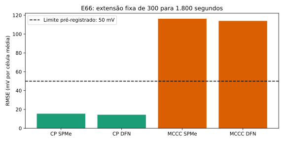

# Etapa 4B — a extensão para 1.800 segundos reprova o candidato no MCCC

**Resultado da campanha estendida: FAIL. A aprovação restrita anterior de 300 segundos permanece circunscrita àquelas janelas; não autoriza generalização ao carregamento longo.** Data: 26/10/2026.

Foram concluídas seis simulações pré-especificadas e quatro diagnósticos térmicos posteriores. Não houve ajuste de parâmetros, abertura dos quatro arquivos cegos finais ou acesso aos 1.152 episódios históricos. Os dois arquivos de validação já haviam sido expostos na campanha anterior: esta extensão é **não cega**, em sessões do mesmo módulo, e não fornece replicação em unidades independentes.

## Protocolo e resultados primários

O commit `ae05470813fa0be1be71ab9f99df179cc4ef03e9` publicou código, critérios, testes e congelamento antes da execução. Foram mantidos os inícios selecionados pela regra anterior, ampliando a duração fixa para 1.800 s, sem cortar trechos de maior erro. As inicializações, a parametrização celular, o adaptador AVL/BMS e as tolerâncias do solver permaneceram congelados. Limites: RMSE ≤50 mV, máximo ≤150 mV, cobertura ≥95%, proxy de SOC em [0,1] e diferença de malha ≤5 mV. Todos os erros são por célula média, isto é, erro de tensão do módulo dividido por seis, não erros individuais medidos em seis células.

| Ensaio | Modelo | RMSE | Máximo | Cobertura | Critério elétrico |
|---|---|---:|---:|---:|---|
| CP 1,5C | SPMe, malha 40 | 15,472 mV | 52,924 mV | 100% | PASS |
| CP 1,5C | DFN, malha 40 | 14,357 mV | 49,808 mV | 100% | PASS |
| MCCC 1,5C | SPMe, malha 40 | 116,262 mV | 196,943 mV | 100% | FAIL |
| MCCC 1,5C | DFN, malha 40 | 113,944 mV | 193,662 mV | 100% | FAIL |



Os controles SPMe de malha 80 mantêm os resultados: CP RMSE 16,879 mV; MCCC 116,253 mV. Diferenças máximas entre malhas: 4,200 mV e 3,571 mV, respectivamente. Esse controle passou; não há evidência de que o refinamento testado remova a falha. Não foi demonstrada convergência geral do DFN.

O SOC contabilizado permaneceu no domínio: CP 0,64224–0,64936; MCCC 0,08279–0,86670. Isso é consistência do proxy, não validação contra SOC real independente. No MCCC SPMe, o RMSE aumenta de 29,052 mV em 0–300 s para 89,676 mV em 300–900 s e 146,281 mV em 900–1.800 s. Os segmentos são descritivos e compartilham os pontos de fronteira; não são réplicas independentes.

## Diagnóstico térmico e do ponto de medição

O modelo primário é isoterma. As nove posições de termopares na célula 4 registram extremos de 30,01–41,78 °C no CP e 29,90–51,91 °C no MCCC. Não são nove células independentes nem medidas de temperatura do núcleo.

Depois da falha primária, o commit `9d046e056e9e994d727fa416a217c038f6c39f90` congelou um diagnóstico posterior: impor ao modelo a média temporal dos nove termopares, sem ajustar qualquer parâmetro, nos dois ensaios e nos dois modelos. A implementação instalada do PyBaMM foi inspecionada: a opção isoterma usa a função de temperatura ambiente como temperatura celular imposta. Esse teste muda uma entrada do cálculo; **não prevê temperatura e não constitui validação térmica**.

| Diagnóstico com temperatura medida imposta | RMSE SPMe | RMSE DFN | Resultado contra os limites elétricos |
|---|---:|---:|---|
| CP 1,5C | 13,983 mV | 14,236 mV | PASS |
| MCCC 1,5C | 101,971 mV | 99,731 mV | FAIL |

No MCCC, os máximos ainda são 177,807 e 173,746 mV. Portanto, fornecer essa aproximação da temperatura medida reduz o erro, mas não basta para explicar ou corrigir a falha. Isso não exclui outros efeitos térmicos; tampouco identifica sozinho a causa remanescente. OCP/capacidade, cinética efetiva, inicialização, heterogeneidade e observação continuam hipóteses a discriminar em desenvolvimento, não justificativas para reajustar aos resultados reservados.

A relação empírica AVL/BMS também apresenta erro no trecho MCCC longo: resíduo RMS de 30,462 mV por célula média, com viés de 28,527 mV. A decomposição algébrica entre erro AVL, erro BMS e resíduo do adaptador foi conferida com discrepância inferior a 1e-10 V. O alvo BMS continua secundário; não substituiu a reprovação no alvo AVL. Não atribuímos o coeficiente empírico a uma resistência física específica sem o circuito de instrumentação.

## Comparação delimitada com A e execução das features

A interface congelada completa recebe demanda de potência do veículo; não oferece replay de corrente laboratorial com conservação de energia demonstrada. Mantivemos A intacto e comparamos sua lei homogênea 1RC, isoterma, nas mesmas correntes e com o mesmo adaptador de observação. Cada modelo inicializa seu próprio SOC pela inversão de sua OCV a partir da mesma tensão BMS de repouso. A usa parâmetros originais e dois índices de envelhecimento declarados, 0 e 0,15, sem ajuste. A discretização mantém a corrente à esquerda e resolve exatamente a evolução RC nesse intervalo; o SOC não é artificialmente limitado. Todos os estados deste comparativo permaneceram em [0,1].

| Ensaio | RMSE A, idade 0 | RMSE A, idade 0,15 | RMSE B SPMe/DFN |
|---|---:|---:|---:|
| CP | 30,989 mV | 29,062 mV | 15,472 / 14,357 mV |
| MCCC | 267,793 mV | 258,513 mV | 116,262 / 113,944 mV |

B tem erro menor nesse comparativo, mas **ambos falham no MCCC longo** sob o limite de 50 mV. Melhorar relativamente a A não equivale a atingir validade absoluta. Isso permanece comparação constitutiva, não validação do backend A ou das perdas do trem de força.

O extrator real `run_stage4_experiments.feature_matrix` foi executado, por um adaptador local explicitamente limitado ao módulo, com tensão e corrente disponíveis. Apenas os análogos de **F20 (energia integrada) e F21 (fração de potência negativa)** tiveram máscara zero. As outras **26 features permaneceram mascaradas**, incluindo F14/F28; não foram inventados contadores, torque, rotação, isolamento, SOC observado ou sensores dos 28 módulos. As chaves do veículo são usadas somente dentro desse teste de compatibilidade da função; os resultados são identificados como módulo, sem publicar linhas de telemetria fictícia do veículo.

Diferenças absolutas de energia F20 entre previsão B e medição: CP 0,004232/0,002566 kWh; MCCC 0,052975/0,048298 kWh (SPMe/DFN). Não foi fixado critério confirmatório para essa métrica posterior. A concordância de F21 é pouco informativa, porque ambos recebem a mesma corrente medida e a tensão permanece positiva. Não é uma validação independente da regeneração do veículo.

## Integridade, testes e reprodução

**184 testes passaram, zero falhas, zero erros e zero ignorados.** Os novos testes verificam a solução analítica RC, sinais de carga/descarga, ausência de truncamento de SOC, integração de energia e preservação das máscaras de contadores. Uma primeira tentativa de execução não decodificou as tabelas MATLAB por ausência de PyArrow. Os recibos dessa falha estão em `failed_environment/`; a dependência foi instalada e as execuções foram repetidas sem mudar modelos ou critérios.

A auditoria recomputou métricas primárias, SOC, refinamento e métricas do diagnóstico térmico a partir das previsões e medições. É uma verificação separada no mesmo ambiente, não auditoria de instituição externa. Os scripts, resultados e logs estão em `results/e66_extended_validation/`; o manifesto SHA-256 permite conferir a entrega. O ZIP original E66 e seus hashes permanecem os mesmos da campanha anterior. Não houve republicação dos dados brutos.

```sh
python scripts/e66_extended_validation.py run
python scripts/audit_e66_extended_validation.py
python scripts/e66_measured_temperature_probe.py run
python scripts/diagnose_e66_extended_ports.py
PYTHONPATH=src/simulator:src:. python -m unittest discover -s tests/unit -v
```

Usar as dependências da campanha anterior, incluindo `pyarrow==26.0.0`, e os recibos celulares restaurados conforme o relatório de 25/10. Os arquivos `FREEZE.json` já estão publicados; não recriá-los para acomodar mudanças. Oxford está disponível nesta retomada, mas não foi analisado nesta campanha; TUM `m1774217_001.zip` continua indisponível, sem nova alegação de reprodução.

## Decisão científica

**Não aprovar o candidato atual para o domínio de carregamento MCCC de 1.800 segundos.** Preservar o PASS limitado anterior, o PASS do CP longo e o FAIL do MCCC como alegações distintas. A campanha foi concluída com resultado negativo útil; a Etapa 4B integral continua não aprovada.

O próximo desenvolvimento deve discriminar as causas em dados de desenvolvimento de carga e descarga, especificar uma interface energética legítima para A e tratar temperatura e observação como componentes explícitos. Qualquer candidato alterado terá novo congelamento e não poderá usar estes dois ensaios já expostos como validação cega. Os quatro arquivos cegos finais permanecem fechados para uma avaliação final devidamente especificada; nenhuma Etapa 5–8 foi iniciada.
