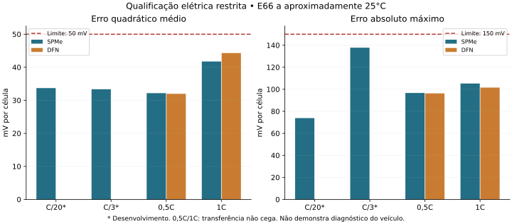

# Etapa 4B — parecer de validação física, 25/10/2026

**Qualificação elétrica restrita: PASS_LIMITED. Aprovação integral da Etapa 4B: NÃO EMITIDA.** A campanha demonstra resposta terminal quantitativa de um gerador eletroquímico efetivo calibrado em dados E66 a aproximadamente 25°C. Não demonstra parametrização eletroquímica única E66, previsão térmica, validação cega de módulo ou diagnóstico de falhas do Taycan 4S.

## Resultado quantitativo

Critérios mantidos: RMSE absoluto ≤50 mV, erro máximo ≤150 mV e cobertura ≥95%. Erros em mV por célula; curvas completas do primeiro segmento de descarga, sem cortar a cauda para esconder falhas.

| Ensaio | Modelo | RMSE (mV) | Máximo (mV) | Cobertura | Gate |
|---|---|---:|---:|---:|---|
| C/20 | SPMe | 33.69 | 73.83 | 100% | PASS |
| C/3 | SPMe | 33.33 | 137.75 | 100% | PASS |
| 0,5C | SPMe | 32.16 | 96.65 | 100% | PASS |
| 0,5C | DFN | 31.96 | 96.29 | 100% | PASS |
| 1C | SPMe | 41.75 | 105.24 | 100% | PASS |
| 1C | DFN | 44.31 | 101.53 | 100% | PASS |

C/20 e C/3 são desenvolvimento. 0,5C e 1C são transferência entre sessões **não cega**, já expostas anteriormente. As 12 previsões GITT (seis segmentos × SPMe/DFN) tiveram RMSE relativo de 6.84 a 24.51 mV e passaram nos limites registrados. Não confundir tensão relativa ao repouso com precisão de OCV absoluta, nem segmentos da mesma célula com células independentes.

## Calibração, falha preservada e correção exploratória

Foram executados 48 solves de desenvolvimento para oito pontos de perfil e oito avaliações do otimizador, três pulsos por avaliação. Multiplicador conjunto das cinéticas: **4.336662**. RMSE de desenvolvimento durante carga: 2.971 mV. Os três mínimos individuais e as três exclusões de um pulso escolheram 4 na grade discreta. Isso verifica consistência condicional, não fornece intervalos de confiança ou identificação separada dos eletrodos.

O primeiro candidato foi congelado no commit `981dff571ce5490307d0b30d50333fbc7900389f`, antes das novas previsões. Ele passou em 0,5C/1C/GITT, mas **falhou em C/3: máximo 160,702 mV**. O controle retrospectivo com cinética original também falha ligeiramente nesse ponto (150,093 mV). A falha está no fim da descarga, a 100% da duração; não foi descartada.

Uma continuação exploratória corrigiu apenas o offset da OCP positiva, usando exclusivamente o negativo da média dos vieses de desenvolvimento C/20 e C/3, com peso igual por curva. Offset adicional: **-22.949115 mV**. Nenhum parâmetro foi ajustado às previsões de 0,5C, 1C ou GITT. O novo congelamento foi publicado em `a4c7b8972e2dba132cc121fac1873b7fd7eb5de7` antes das oito previsões de seguimento.

A escolha de investigar esse componente ocorreu depois de resultados anteriores: portanto, a sequência é adaptativa e exploratória. Os resultados atuais não são evidência confirmatória de um protocolo jamais exposto. O candidato reprovado, seus critérios e recibos permanecem intactos.

## Controle numérico e físico

- Refinamento SPMe 40→80: HPPC mediano, máximo 1,961 mV; primeiro GITT, 0,586 mV. Ambos abaixo de 5 mV. É um controle localizado; não comprova convergência global de todos os modelos e domínios.
- O offset uniforme deve somar-se à tensão absoluta e cancelar-se na tensão relativa. As simulações verificaram essa relação, inclusive HPPC/GITT. Em DFN 1C, a tolerância inicial produziu discrepância 4,618 µV, falhando o limite numérico de 1 µV. A falha original foi preservada. Com rtol=1e-9 e atol=1e-10, o controle resulta **PASS**, discrepância 0.009387 µV. Os parâmetros e o limite não mudaram. A herança dos controles relativos de malha/inventário depende dessa identidade verificada, não de reexecução de todos eles.
- Três controles de inventário SPMe, SOC inicial 20%, 60%, 80%: deriva relativa máxima de lítio 2.11e-15; erro máximo de integração de capacidade 3.54e-08 Ah; estequiometrias dentro de [0,1] e tensão finita. Isso é conservação numérica da célula virtual Chen derivada, não medida de inventário de lítio E66 nem balanço térmico do veículo.
- Quatro perturbações declaradas no primeiro GITT: SOC ±2 pontos percentuais e temperatura inicial ±5 K; todas completadas. São cenários condicionais, não intervalos de incerteza instrumentais.
- Auditoria de sensores: vieses de tensão ±5 mV, atrasos ±0,1 s e 20% de ausências com seed1729, sem reajuste. Resultados detalhados em `INDEPENDENT_AUDIT.json`. A interpolação usa a grade de avaliação; não representa um novo ensaio físico com falhas reais.
- 165 testes unitários completos, 0 falhas e 0 erros. A suíte foi executada com `PYTHONPATH=src/simulator:src:.` e recibo estruturado de conclusão. Nenhum resultado de execução incompleta foi tratado como aprovação.

## Comparação A × B e alcance diagnóstico

A foi avaliado somente pela redução analítica de sua lei celular 1RC sob corrente constante e repouso, com temperatura fixa e dois níveis de envelhecimento declarados (0 e 0,15), sem ajuste. RMSE relativo mediano HPPC: 33,91/32,30 mV; GITT: 23,32/21,92 mV. Trata-se de comparação constitutiva, não replay do backend completo A. A lei congelada de A permaneceu inalterada.

| Alegação | Parecer |
|---|---|
| Resposta terminal nas sessões celulares avaliadas, dentro dos limites registrados | PASS restrito e não cego |
| Identificação única dos parâmetros físicos dos eletrodos E66 | INCONCLUSIVO |
| Modelo térmico real E66/Taycan validado | NÃO DEMONSTRADO: cálculo isoterma |
| H00 como classe diagnóstica do veículo completo | INCONCLUSIVO; apenas resposta elétrica nominal estudada |
| B01–B04: capacidade, resistência, desequilíbrio e fuga de ramo | INCONCLUSIVO: sem ensaios de falha externos rotulados nesta campanha |
| B05/B06: origem e identificação de defeitos de sensores | INCONCLUSIVO; stress sintético não é validação de falhas reais |
| B07/B08/B09: refrigeração, sensor térmico e isolamento | NÃO COBERTOS pelo gerador celular estudado |
| M01/I01: motor/inversor | NÃO COBERTOS por SPMe/DFN |
| Transferência das 28 features e 28 máscaras do veículo | NÃO DEMONSTRADA |
| F14/F28 externamente validados | NÃO: contadores independentes não disponíveis; integrar a mesma corrente seria circular |
| Generalização a módulos reservados, outras células/temperaturas e Taycan 4S | INCONCLUSIVO |

Não foi criada uma matriz de features fictícia a partir de estados internos. Ausência de observáveis não foi preenchida com verdades do simulador. Não foi treinado classificador e não houve avanço às Etapas 5–8.

## Proveniência, dados protegidos e reprodução

Dados laboratoriais: Uwalaka, Yao, Duque e Kollmeyer (2024), [DOI 10.5683/SP3/7JP3NM](https://doi.org/10.5683/SP3/7JP3NM), CC BY4.0. Apenas os arquivos celulares 25°C já autorizados foram analisados. **Zero acesso numérico novo aos dois arquivos de validação e quatro cegos de módulo; zero acesso aos 1.152 testes históricos.** Leitura de bytes para hash do ZIP não é análise dos experimentos reservados.

O recibo de OCP original continua sendo reconstrução post-hoc; não foi promovido a congelamento original recuperado. A nova calibração possui congelamentos próprios. As cópias exatas dos recibos de entrada e sua proveniência estão em `results/e66_kinetic_calibration/input_receipts/`, evitando dependência exclusiva de artefatos CI expirantes.

Ambiente: Python3.12.14, PyBaMM26.4.2, NumPy2.3.5, SciPy1.17.0, CasADi3.7.2, pybammsolvers0.6.0. Consulte `REPRODUCE.md`, freezes e manifestos SHA256. Dados brutos e séries experimentais completas não foram republicados. O arquivo CAN `m1774217_001.zip` não estava disponível nesta rodada: os resultados TUM anteriores não foram reproduzidos aqui.

## Decisão científica

O gargalo de resposta elétrica nominal avançou de uma demonstração Chen2020 sem ajuste E66 para um **surrogato eletroquímico efetivo, calibrado, congelado e testado quantitativamente em sessões E66 separadas**. Há evidência favorável dentro do domínio medido e das métricas declaradas.

Isso sustenta submeter uma **qualificação elétrica restrita** à revisão formal. Não sustenta aprovar a 4B integral, declarar validação diagnóstica externa ou abrir testes históricos. Para uma alegação externa mais forte, ainda é necessária avaliação realmente independente em unidade/domínio não usados no desenvolvimento, com instrumentação de módulo resolvida e pipeline apropriado. A previsão térmica e a transferência das features do veículo exigem modelos/observáveis próprios; aumentar o número destas simulações não substitui essas evidências.
